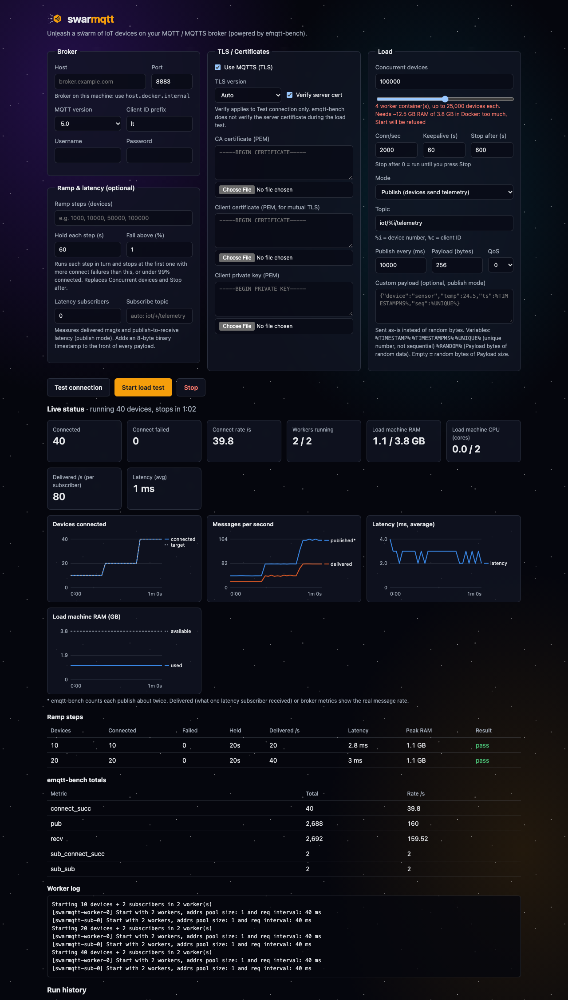

<p align="center"></p>

<p align="center"><b>Unleash a swarm of IoT devices on your MQTT broker.</b></p>

# swarmqtt

Web UI สำหรับ load test MQTT / MQTTS broker จำลอง IoT device ได้เป็นแสนตัว
ฝั่ง load ใช้ [emqtt-bench](https://github.com/emqx/emqtt-bench) และฝั่ง UI แตก worker container ให้อัตโนมัติ



## ใช้งาน

ไม่ต้อง clone repo: pull image จาก ghcr แล้วรันได้เลย (มี amd64 และ arm64)

```sh
docker run -d --name swarmqtt --restart unless-stopped \
  -p 127.0.0.1:8080:8080 -p 127.0.0.1:8081:8081 \
  -v /var/run/docker.sock:/var/run/docker.sock \
  -v swarmqtt-certs:/certs -v swarmqtt-data:/data \
  --add-host host.docker.internal:host-gateway \
  ghcr.io/kit09k/swarmqtt:latest       # เปิด http://localhost:8080
docker pull ghcr.io/kit09k/swarmqtt:latest && docker rm -f swarmqtt   # อัปเดต แล้วรันคำสั่งบนใหม่
docker rm -f swarmqtt                  # ปิด UI (ให้กด Stop ก่อนเพื่อลบ worker)
```

worker ใช้ image เดียวกับที่ UI รันอยู่โดยอัตโนมัติ ไม่ต้องตั้ง env

ถ้า clone repo มาแล้วใช้ compose แทนก็ได้ (log ของ worker จะอยู่ที่ `./logs`):

```sh
docker compose pull && docker compose up -d   # เปิด http://localhost:8080
UI_PORT=18080 docker compose up -d            # ถ้า port 8080 ไม่ว่าง
docker compose up -d --build                  # build เองจาก source แทน pull
docker compose down                           # ปิด UI (ให้กด Stop ก่อนเพื่อลบ worker)
```

1. กรอก Broker (host, port, MQTT version, user/pass) ถ้า broker รันบนเครื่องนี้ ให้ใช้ `host.docker.internal`
2. TLS: เปิด MQTTS, วางหรืออัปโหลด CA / client cert / client key (PEM)
3. กด **Test connection**: ต่อ 1 connection ด้วย paho-mqtt และ verify cert จริงถ้าติ๊ก Verify
4. ตั้ง **Concurrent devices**, Conn/sec (ยอดรวมทุกเครื่อง controller จะแบ่งให้เท่าๆ กัน), mode (publish / subscribe / connect only), topic, ความถี่, payload, QoS
   - **Connect retries**: ตั้งให้ device ที่ต่อไม่สำเร็จลองใหม่ N ครั้ง (0-10, ค่าเริ่ม 0) ก่อนนับเป็น connect_fail (การ retry นับใน connect_retried)
   - **Publish together**: ให้แต่ละ worker container รอจนเริ่มเชื่อมต่อครบทุก client ก่อน แล้วทุก client ใน worker นั้นจึงเริ่ม publish พร้อมกัน (แยกกันทำในแต่ละ worker container ไม่ได้ sync ข้าม worker หรือข้ามเครื่อง)
   - **Stop after (min, s)**: หยุดเองเมื่อครบเวลา ใส่เป็นนาทีกับวินาที (ค่าเริ่ม 10 นาที, ใส่ 0 นาที 0 วินาที = รันจนกด Stop) กันลืมปล่อย load ค้าง
   - **Custom payload** (ไม่บังคับ): ใส่ข้อความ/JSON ที่จะส่งจริงแทน random bytes ใช้ตัวแปรได้ `%TIMESTAMP%`, `%TIMESTAMPMS%`, `%UNIQUE%` (เลขไม่ซ้ำต่อข้อความ ไม่เรียงลำดับ อาจติดลบ), `%RANDOM%` (random ขนาดเท่า Payload bytes), `%RANGE:<min>:<max>%` (สุ่มค่าใหม่ในขอบเขตทุกข้อความ), `%WALK:<min>:<max>:<step>%` (random walk แยกค่าต่อ device ขยับค่าแบบสุ่มไม่เกิน step ต่อข้อความ) ทศนิยมตามตัวเลขที่ละเอียดสุดใน placeholder (`40:60` เป็นจำนวนเต็ม, `20.0:30.0` ทศนิยมหนึ่งตำแหน่ง) หากพิมพ์ผิดจะถูกปฏิเสธ เช่น `{"temp":%WALK:20.0:30.0:0.2%,"hum":%RANGE:40:60%,"ts":%TIMESTAMPMS%}` สูงสุด 256 KB (image ของ swarmqtt มี emqtt-bench ตัวที่แพตช์แล้วอยู่ในตัวและใช้รัน worker ด้วย จึงใช้ได้ทุกเครื่องทั้ง controller และ peers ส่วน `BENCH_IMAGE` ไม่บังคับ ใช้ override worker image เท่านั้น ถ้าใช้ stock `emqx/emqtt-bench:latest` จะไม่รับ %RANGE/%WALK)
5. กด **Start load test** แล้วดู connected / failed / rate / กราฟ / log สดๆ ส่วน **Stop** ลบ worker ทั้งหมด

### หาเพดานของ broker (ramp อัตโนมัติ)

กล่อง **Ramp & latency** ใส่ **Ramp steps** เช่น `1000, 10000, 50000, 100000` ระบบจะรันตามลำดับที่เขียนและใส่ซ้ำได้ (เช่น `100000, 100000` รัน 100k สองรอบ ทุกขั้นต่อใหม่ตั้งแต่ศูนย์)
รอให้ต่อครบแล้วค้างไว้ตาม **Hold each step** และหยุดเองที่ขั้นแรกที่ connect fail เกิน **Fail above (%)**
หรือต่อได้ไม่ถึง 99% (ทุกขั้นต่อใหม่ตั้งแต่ศูนย์) ถ้า RAM เครื่องยิงเต็มก่อน จะบันทึกว่าขั้นนั้นวัดเครื่องยิง ไม่ใช่ broker

### วัด latency

ใส่ **Latency subscribers** (เช่น 2) ระบบจะเพิ่ม subscriber ที่ subscribe topic ของทุก device (`iot/%i/telemetry` → `iot/+/telemetry`)
แล้ววัด **delivered msg/s** (ที่ broker ส่งถึงจริง) และ **latency เฉลี่ย publish → receive**
ข้อแลก: payload ทุกข้อความจะมี timestamp binary 8 byte นำหน้า (ถ้าระบบปลายทาง parse JSON ให้ใช้ topic แยกสำหรับเทส)

### ผลย้อนหลังและรายงาน PDF

ทุกครั้งที่กด Start ถูกบันทึกเป็น 1 run ใน docker volume (ไม่เก็บ password / key / cert)
ตาราง **Run history** ด้านล่างดาวน์โหลดได้ทั้ง **PDF report** (สรุปผล, setup, ผลแต่ละขั้น, กราฟ, ข้อควรระวัง), **CSV** (ค่าทุก 2 วินาที) และ **JSON**
หรือเรียกตรง: `GET /api/runs`, `/api/runs/<id>.json`, `/api/runs/<id>.csv`, `/api/runs/<id>/report.pdf`

### ยิงจากหลายเครื่อง

เมื่อ RAM หรือ source port ของเครื่องเดียวไม่พอ ให้รัน swarmqtt บนเครื่องอื่นเป็น peer แล้วให้เครื่องหลัก (controller) แบ่ง device ให้

```sh
# บนแต่ละ peer (เปิด peer API ให้เครื่องอื่นเรียกได้ ต้องมี token)
PEER_TOKEN=รหัสยาวๆ PEER_BIND=0.0.0.0 docker compose up -d

# บน controller
PEER_TOKEN=รหัสยาวๆ PEERS=http://10.0.0.2:8082,http://10.0.0.3:8082 docker compose up -d
```

ถ้าใช้ `docker run` บน peer ให้เพิ่ม `-p 0.0.0.0:8082:8082 -e PEER_TOKEN=รหัสยาวๆ` ส่วน controller เพิ่ม `-e PEER_TOKEN=รหัสยาวๆ -e PEERS=http://10.0.0.2:8082`
สร้าง token ได้ด้วย `openssl rand -hex 24` ทุกเครื่องต้องใช้ค่าเดียวกัน

controller แบ่ง device และ Conn/sec ตาม capacity ของแต่ละเครื่อง (RAM และ port cap บน Mac) หรือปรับสัดส่วนเองได้ในกล่อง Machines บน UI (เลข client ไม่ซ้ำกัน, rate อย่างน้อย 1 ต่อเครื่องที่ได้ device) สั่ง start/stop ทุกเครื่อง และรวมยอด/RAM/CPU ให้ในหน้าเดียว
ramp ใช้ได้ตามปกติ peer จะหยุดเองตามเวลาแม้ controller ดับ ส่วน latency subscriber รันที่ controller เท่านั้น
peer API (port 8082) รับแค่ start / stop / status และต้องมี `Authorization: Bearer <PEER_TOKEN>`
แต่ค่า config (รวม password และ client key) ส่งเป็น HTTP ธรรมดา **ให้ใช้ใน network ที่ไว้ใจได้หรือผ่าน VPN เท่านั้น**

แต่ละ worker container รับไม่เกิน 25,000 device เช่น 100,000 device = 4 worker
การแบ่ง worker ช่วยกระจาย CPU/RAM แต่**ไม่ได้เพิ่ม source port**: connection ทุกตัวออกจาก address ของเครื่องที่รัน Docker
(บน Linux ได้ราว 64k port ต่อ broker host:port หนึ่งตัว)

**รันบน Mac มี device cap ต่อเครื่อง**: Docker บน macOS (OrbStack, Docker Desktop) เปิด connection ของทุก container
ใหม่จากตัว Mac เอง ซึ่งมี ephemeral port ค่าเริ่มต้น 49152–65535 (16,384 port, ดูด้วย `sysctl net.inet.ip.portrange.first net.inet.ip.portrange.last`)
ค่าเริ่มต้น 15,000 จึงพอดีกับ stock range นี้ หากต้องการเพิ่ม ให้ขยาย port range บน Mac ด้วย `sudo sysctl -w net.inet.ip.portrange.first=10000`
(ได้ 55,536 port, รีเซ็ตเมื่อ reboot) แล้วใส่ `MAC_MAX_DEVICES=50000` ใน `.env` จากนั้น `docker compose up -d` เมื่อขยายแล้ว RAM จะกลายเป็นขีดจำกัดแทน
ถ้ามี peer ตัว cap นี้จะนับต่อเครื่องเพราะ controller แบ่ง device ตาม capacity ของแต่ละเครื่อง หรือจะรัน swarmqtt บนเครื่อง Linux ที่อยู่ network เดียวกับ broker ก็ได้

## MCP (ให้ AI agent สั่ง load test เอง)

container เดียวกันเปิด MCP server ไว้ที่ `http://localhost:8081/mcp` (streamable HTTP เปลี่ยน port ได้ด้วย `MCP_PORT`)

```sh
# Claude Code
claude mcp add --transport http swarmqtt http://localhost:8081/mcp
```

client อื่นที่รองรับ HTTP MCP:

```json
{ "mcpServers": { "swarmqtt": { "type": "http", "url": "http://localhost:8081/mcp" } } }
```

| Tool | ทำอะไร |
|------|--------|
| `test_connection` | ต่อ broker 1 connection (verify cert ได้) แล้วบอกผล / latency / error |
| `start_load_test` | เริ่ม load test ตามจำนวน `devices` (แทนที่ test ที่รันอยู่) หยุดเองตาม `duration_sec` (ค่าเริ่ม 600) |
| `get_status` | ยอด connect_succ / connect_fail / pub, worker, RAM/CPU ของเครื่องยิง, เวลาที่เหลือ, log ล่าสุด |
| `stop_load_test` | หยุดและลบ worker ทั้งหมด |
| `list_runs` | run ย้อนหลัง (ล่าสุดก่อน) พร้อมขั้นใหญ่สุดที่ผ่าน |
| `get_run` | ผลของ run: สรุป 1-2 ประโยค, ผลแต่ละขั้น, ลิงก์ PDF / CSV / JSON |

`start_load_test` รับ `ramp_steps` (เช่น `[1000, 10000, 50000]` รันตามลำดับที่เขียนและใส่ซ้ำได้), `hold_sec`, `fail_pct` สำหรับหาเพดาน,
`connect_retries`, `wait_before_publishing` และ `subscribers` สำหรับวัด latency

ตัวอย่าง prompt: *"ทดสอบต่อ broker.example.com:8883 แบบ MQTTS ก่อน ถ้าผ่านให้ ramp 1k, 10k, 50k พร้อมวัด latency แล้วส่งลิงก์ PDF report มา"*

cert ส่งเป็นเนื้อหา PEM (ไม่ใช่ path) เพราะ server รันใน container มองไม่เห็นไฟล์บนเครื่อง

## Agent skill

`skills/swarmqtt-load-test/` เป็น skill ที่สอน AI agent ให้ load test อย่างถูกวิธี: ยืนยันเป้าหมาย, เช็ค RAM เครื่องยิง,
test connection, smoke test, ramp ทีละขั้น, เกณฑ์หยุด, อ่านตัวเลขให้ถูก, หยุด worker ทุกครั้ง และเขียนรายงาน

```sh
cp -r skills/swarmqtt-load-test ~/.claude/skills/     # Claude Code (ทุกโปรเจกต์)
```

ใช้คู่กับ MCP ข้างบน (ถ้าไม่ได้ต่อ MCP skill จะใช้ HTTP API แทน)

## ข้อควรรู้

- **ต้องเตรียม RAM เยอะ**: วัดได้ว่า worker 1 ตัวใช้ ~575 MB บวก ~107 KB ต่อ TLS connection (MQTT ธรรมดา ~40 KB, ประมาณไว้ 50 KB)
  100k device ≈ 13 GB ฝั่ง bench อย่างเดียว (ถ้าใช้ Docker Desktop/colima ต้องเพิ่ม memory ของ VM)
  UI แสดง RAM ที่ต้องใช้เทียบกับที่ Docker มีตอนตั้งจำนวน device และ **ไม่ยอมเริ่ม** ถ้าเกิน 90% (กัน VM ล่มกลางทาง)
  ระหว่างรันดูการ์ด Load machine RAM/CPU ถ้าใกล้เต็ม แปลว่าคอขวดอยู่ที่เครื่องยิง ไม่ใช่ broker
  ถ้าเกินเครื่องเดียว ใช้ [ยิงจากหลายเครื่อง](#ยิงจากหลายเครื่อง)
- **ค่าเริ่ม Conn/sec คือ 500 (ยอดรวมทุกเครื่อง)**: controller แบ่ง rate ให้แต่ละเครื่องเท่าๆ กัน บน Mac ถ้าเปิดเร็วระดับ 2,000/s ตัว proxy ของ OrbStack ตามไม่ทัน connection ค้างไปราวหนึ่งนาที
  แล้วโดน `pingresp_timeout` / `keepalive_timeout` ทั้งที่ broker ปกติ ค่อยเพิ่ม rate เมื่อรันจากเครื่อง Linux
- **log ของ worker ถูกเก็บก่อนลบ**: กด Stop, หมดเวลา Stop after หรือเปลี่ยนขั้น ramp แล้ว log เต็มของทุก worker จะอยู่ที่ `logs/<เวลา>-swarmqtt-worker-N.log`
  (UI แสดงแค่ 50 บรรทัดล่าสุด) ใช้นับ `pingresp_timeout` / error ได้ครบ
- **ตอน load test ไม่ verify cert ของ broker** (เป็นข้อจำกัดของ emqtt-bench) CA จึงใช้แค่ตอน Test connection
- **ตัวเลข `pub` ที่ emqtt-bench รายงานเป็น ~2 เท่าของที่ broker ได้รับจริง** ให้ดู delivered (ต้องเปิด latency subscribers) หรือ message rate จากฝั่ง broker
- **Connected คือยอดสะสมของการต่อสำเร็จ** ไม่ได้หักตัวที่หลุดภายหลัง ให้เทียบกับจำนวน connection ที่ broker เห็น
- **UI และ MCP คุม Docker ได้** (mount `docker.sock`) จึง bind แค่ `127.0.0.1` ห้ามเปิดออก network (MCP กัน DNS rebinding ด้วยการเช็ค Host/Origin ด้วย)
- cert/key ที่ใส่จะถูกเก็บใน docker volume `swarmqtt-certs` ส่วน browser จำค่าในฟอร์มไว้ ยกเว้น password และ private key
- ถ้า restart ตัว web ระหว่างรัน worker ยังทำงานต่อและหยุดตามเวลาเดิม แต่ ramp ที่เหลือจะไม่รันต่อ (run ถูกบันทึกเป็น interrupted)
