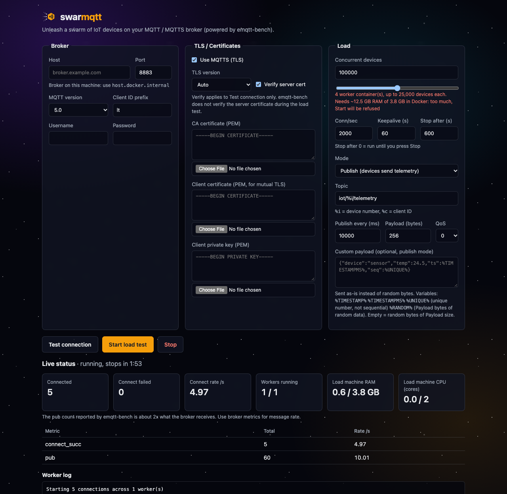

<p align="center"></p>

<p align="center"><b>Unleash a swarm of IoT devices on your MQTT broker.</b></p>

# swarmqtt

Web UI สำหรับ load test MQTT / MQTTS broker จำลอง IoT device ได้เป็นแสนตัว
ฝั่ง load ใช้ [emqtt-bench](https://github.com/emqx/emqtt-bench) และฝั่ง UI แตก worker container ให้อัตโนมัติ



## ใช้งาน

```sh
docker compose up -d --build          # เปิด http://localhost:8080
UI_PORT=18080 docker compose up -d    # ถ้า port 8080 ไม่ว่าง
docker compose down                   # ปิด UI (ให้กด Stop ก่อนเพื่อลบ worker)
```

1. กรอก Broker (host, port, MQTT version, user/pass) ถ้า broker รันบนเครื่องนี้ ให้ใช้ `host.docker.internal`
2. TLS: เปิด MQTTS, วางหรืออัปโหลด CA / client cert / client key (PEM)
3. กด **Test connection**: ต่อ 1 connection ด้วย paho-mqtt และ verify cert จริงถ้าติ๊ก Verify
4. ตั้ง **Concurrent devices**, connections/sec, mode (publish / subscribe / connect only), topic, ความถี่, payload, QoS
   - **Stop after (s)**: หยุดเองเมื่อครบเวลา (ค่าเริ่ม 600, ใส่ 0 = รันจนกด Stop) กันลืมปล่อย load ค้าง
   - **Custom payload** (ไม่บังคับ): ใส่ข้อความ/JSON ที่จะส่งจริงแทน random bytes ใช้ตัวแปรได้ `%TIMESTAMP%`, `%TIMESTAMPMS%`, `%UNIQUE%` (เลขไม่ซ้ำต่อข้อความ ไม่เรียงลำดับ อาจติดลบ), `%RANDOM%` (random ขนาดเท่า Payload bytes) เช่น `{"temp":24.5,"ts":%TIMESTAMPMS%,"seq":%UNIQUE%}` สูงสุด 256 KB
5. กด **Start load test** แล้วดู connected / failed / rate / log สดๆ ส่วน **Stop** ลบ worker ทั้งหมด

แต่ละ worker container รับไม่เกิน 25,000 device (มี IP ของตัวเอง ไม่ติด limit ~64k source port ต่อ IP)
เช่น 100,000 device = 4 worker

## MCP (ให้ AI agent สั่ง load test เอง)

container เดียวกันเปิด MCP server ไว้ที่ `http://localhost:8081/mcp` (streamable HTTP เปลี่ยน port ได้ด้วย `MCP_PORT`)

```sh
# Claude Code
claude mcp add --transport http swarmqtt http://localhost:8081/mcp
```

client อื่นที่รองรับ HTTP MCP:

```json
{ "mcpServers": { "swarmqtt": { "type": "http", "url": "http://localhost:8081/mcp" } } }
```

| Tool | ทำอะไร |
|------|--------|
| `test_connection` | ต่อ broker 1 connection (verify cert ได้) แล้วบอกผล / latency / error |
| `start_load_test` | เริ่ม load test ตามจำนวน `devices` (แทนที่ test ที่รันอยู่) หยุดเองตาม `duration_sec` (ค่าเริ่ม 600) |
| `get_status` | ยอด connect_succ / connect_fail / pub, worker, RAM/CPU ของเครื่องยิง, เวลาที่เหลือ, log ล่าสุด |
| `stop_load_test` | หยุดและลบ worker ทั้งหมด |

ตัวอย่าง prompt: *"ทดสอบต่อ broker.example.com:8883 แบบ MQTTS ก่อน ถ้าผ่านให้ยิง 1,000 device แล้วค่อยเพิ่มเป็น 10,000 ถ้า connect_fail เป็น 0"*

cert ส่งเป็นเนื้อหา PEM (ไม่ใช่ path) เพราะ server รันใน container มองไม่เห็นไฟล์บนเครื่อง

## Agent skill

`skills/swarmqtt-load-test/` เป็น skill ที่สอน AI agent ให้ load test อย่างถูกวิธี: ยืนยันเป้าหมาย, เช็ค RAM เครื่องยิง,
test connection, smoke test, ramp ทีละขั้น, เกณฑ์หยุด, อ่านตัวเลขให้ถูก, หยุด worker ทุกครั้ง และเขียนรายงาน

```sh
cp -r skills/swarmqtt-load-test ~/.claude/skills/     # Claude Code (ทุกโปรเจกต์)
```

ใช้คู่กับ MCP ข้างบน (ถ้าไม่ได้ต่อ MCP skill จะใช้ HTTP API แทน)

## ข้อควรรู้

- **ต้องเตรียม RAM เยอะ**: วัดได้ว่า worker 1 ตัวใช้ ~575 MB บวก ~107 KB ต่อ TLS connection
  100k device ≈ 13 GB ฝั่ง bench อย่างเดียว (ถ้าใช้ Docker Desktop/colima ต้องเพิ่ม memory ของ VM)
  UI แสดง RAM ที่ต้องใช้เทียบกับที่ Docker มีตอนตั้งจำนวน device และ **ไม่ยอมเริ่ม** ถ้าเกิน 90% (กัน VM ล่มกลางทาง)
  ระหว่างรันดูการ์ด Load machine RAM/CPU ถ้าใกล้เต็ม แปลว่าคอขวดอยู่ที่เครื่องยิง ไม่ใช่ broker
  ถ้าเกินเครื่องเดียว ให้รัน UI นี้หลายเครื่อง แต่ละเครื่องรับส่วนหนึ่ง และตั้ง Client ID prefix ไม่ให้ซ้ำกัน
- **ตอน load test ไม่ verify cert ของ broker** (เป็นข้อจำกัดของ emqtt-bench) CA จึงใช้แค่ตอน Test connection
- **ตัวเลข `pub` ที่ emqtt-bench รายงานเป็น ~2 เท่าของที่ broker ได้รับจริง** ให้ดู message rate จากฝั่ง broker
- **UI และ MCP คุม Docker ได้** (mount `docker.sock`) จึง bind แค่ `127.0.0.1` ห้ามเปิดออก network (MCP กัน DNS rebinding ด้วยการเช็ค Host/Origin ด้วย)
- cert/key ที่ใส่จะถูกเก็บใน docker volume `swarmqtt-certs` ส่วน browser จำค่าในฟอร์มไว้ ยกเว้น password และ private key
